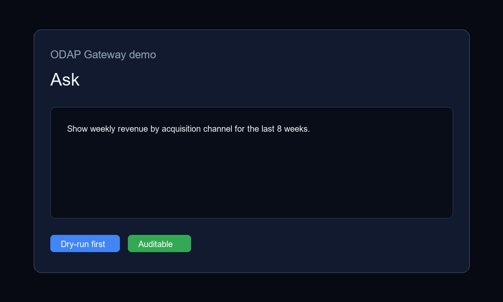

<p align="center">
  
</p>

<p align="center"><em>Workflow overview using demo data. A real operation recording is planned for v0.1.1.</em></p>

# ODAP Gateway

**A reference implementation of the [ODAP Five Musts](https://github.com/open-data-agent-platform/awesome-odap/blob/main/RUBRIC.md): a governed gateway for AI agents querying enterprise data. Starting with BigQuery, done deeply.**

Every query is schema-grounded, cost-estimated via dry-run **before** execution,
routed through approval flows when risky, and written to an audit trail.

> ODAP (Open Data Agent Platform) is an open, CC0 standard: when an AI agent
> touches enterprise data, it must pass through a gateway that is **Open,
> Semantic, Governed, Auditable, and Cost-controlled.**
> Standard and rubric: [awesome-odap](https://github.com/open-data-agent-platform/awesome-odap) |
> Manifesto: [googlesql.com/odap/manifesto](https://googlesql.com/odap/manifesto)

## What it does

- **Schema-aware Text-to-SQL** - generation grounded in approved tables and fields.
- **Dry-run first, always** - bytes scanned, estimated cost, and runtime are surfaced before execution.
- **Approval flows** - high-cost or policy-sensitive queries route to reviewers.
- **Audit trail** - logins, dry-runs, approvals and policy changes are recorded. Deployment rollback is unsupported; historical rollback audit entries are not evidence of execution.
- **Role-based access** - OAuth-protected sessions and admin-only governance routes.

## Standard conformance

This codebase is mapped clause-by-clause against the ODAP Scoring Rubric v1.0,
including what is **not** implemented yet. See
[ODAP_CLAUSE_MAPPING.md](ODAP_CLAUSE_MAPPING.md). Honest gaps > green checkmarks.

## Stack

Next.js (App Router) | Cloudflare Workers and Functions | D1 (SQLite) |
BigQuery API | TypeScript.

## Run locally

```bash
npm install
cp .dev.vars.example .dev.vars
cp wrangler.example.jsonc wrangler.jsonc
npx wrangler d1 create odap-gateway-db
npx wrangler d1 execute odap-gateway-db --file=db/schema.sql
npm run dev
```

You will need a Google Cloud project with the BigQuery API enabled, plus OAuth
credentials for sign-in. See `docs/AUTH_SETUP.md`.

## Status

Experimental development: a [local semantic registry prototype](docs/SEMANTIC_REGISTRY_PROTOTYPE.md)
supports candidate review, owner approval, immutable release IDs, and query
binding records. It is a CLI experiment with trusted operator inputs, not a
production authorization service or NVIDIA integration.

**Early-stage reference implementation (v0.1.x). APIs subject to change.**

## Contributing and challenging

### Design discussions

Optional [design proposals](https://github.com/open-data-agent-platform/awesome-odap/blob/main/docs/design-proposals.md)
cover human-reviewed semantic candidates (including possible NVIDIA Auto Ontology
adapters), delegated identity and session policies, and cost/audit evidence.
Join [discussion #8](https://github.com/open-data-agent-platform/awesome-odap/issues/8).
These optional proposals do not describe implemented v0.1.0 features. The Five Musts,
Rubric, and current clause mapping are unchanged.

PRs welcome. If you think a Rubric clause is mapped wrong, or a Must is
implemented worse than claimed, [file an issue](../../issues). The ODAP
standard's public challenge process applies to its reference implementation too.

## License

Apache-2.0. The ODAP standard itself is CC0 and maintained separately at
[awesome-odap](https://github.com/open-data-agent-platform/awesome-odap).
