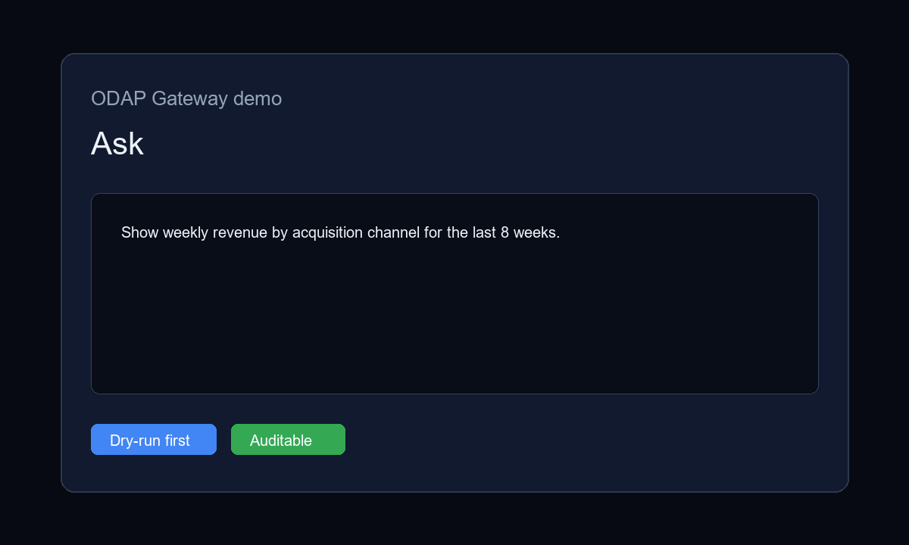

<p align="center">
  
</p>

<p align="center"><em>Illustrative workflow using demo data, not a recording of production execution.</em></p>

# ODAP Gateway

**A reference implementation of the [ODAP Five Musts](https://github.com/open-data-agent-platform/awesome-odap/blob/main/RUBRIC.md): governed data access for AI agents, with BigQuery workflows and a bounded PostgreSQL Node host.**

**Preview 0.3.0-preview.1.** This release contains local and authenticated
control workflows; it is not a completed Gateway acceptance or a configured
production warehouse integration. APIs remain subject to change.

[Release notes](docs/RELEASE_0_3_0_PREVIEW_1.md) summarize PostgreSQL scope,
reproducible verification and the remaining production boundaries.

> ODAP (Open Data Agent Platform) is an open, CC0 standard: when an AI agent
> touches enterprise data, it must pass through a gateway that is **Open,
> Semantic, Governed, Auditable, and Cost-controlled.**
> Standard and rubric: [awesome-odap](https://github.com/open-data-agent-platform/awesome-odap) |
> Manifesto: [googlesql.com/odap/manifesto](https://googlesql.com/odap/manifesto)

## What it does

- **Demo SQL drafting** - local rules use a bundled sample schema, not a general-purpose model or live tenant catalog.
- **Structured metric previews** - compile against eligible, tenant-scoped Semantic Releases. Compilation is not a warehouse dry-run, cost estimate or execution grant.
- **Governed objects** - authenticated APIs and review interfaces manage Semantic Releases, Approval Contracts and Evidence Receipts. Legacy approve/block records do not issue contracts or dispatch jobs.
- **Evidence and recovery** - local adapter tests cover budget admission, handoff, terminal observation, settlement and export verification. Independent integration and pilot evidence are still required.
- **Role-based access** - configured OAuth identities, current administrator authority and tenant membership checks protect their respective routes. Deployment alone does not configure login or enroll an administrator.

The raw SQL editor's production dry-run path and the legacy production schema
importer are disabled, including when service-account credentials are present.
Do not switch production to demo mode to bypass these refusals. Demo estimates
are not actual billing or measured execution time. The separate release-bound
adapter needs its own authority, budget and operational configuration.
See [deployment boundaries](docs/WORKERS_DEPLOYMENT.md) and
[Gateway documentation](https://googlesql.com/gateway/docs).

## Standard conformance

This codebase is mapped clause-by-clause against the ODAP Scoring Rubric v1.0,
including what is **not** implemented yet. See
[ODAP_CLAUSE_MAPPING.md](ODAP_CLAUSE_MAPPING.md). Honest gaps > green checkmarks.

## Stack

Next.js (App Router) | Cloudflare Workers and Functions | D1 (SQLite) |
BigQuery API | PostgreSQL via a separate Node.js host | TypeScript.

## Run locally

```bash
npm install
cp .dev.vars.example .dev.vars
cp wrangler.example.jsonc wrangler.jsonc
npx wrangler d1 create odap-gateway-db
npx wrangler d1 execute odap-gateway-db --file=db/schema.sql
npm run dev
```

You will need a Google Cloud project with the BigQuery API enabled, plus OAuth
credentials for sign-in. See `docs/AUTH_SETUP.md`.

## Status

See [integrations](integrations/README.md) for runnable adapters, supported
versions, and explicit validation boundaries. Framework evidence tools are
separate from query execution and do not configure production authentication.

The [database adapter matrix](docs/DATABASE_ADAPTERS.md) separates the BigQuery
adapter from the [governed PostgreSQL Node host](docs/POSTGRESQL_CONNECTOR.md).
PostgreSQL supports released, single-table COUNT/SUM reads with tenant RLS,
approval, signed Agent delegation, bounded cancellation, durable recovery and
detached local evidence verification. Synthetic real-engine CI covers exact
15.20, 16.16, 17.12 and 18.7 builds. This is not arbitrary SQL support, a deployed
Worker PostgreSQL endpoint, independent acceptance or a production pilot.
The offline inspector never grants authority or claims live provider verification.

The [offline NVIDIA import adapter](docs/NVIDIA_IMPORT.md) stages version-pinned
SQL attribute context and an explicit local metric mapping for candidate review.
Upstream certification never grants Gateway approval or execution; live import
and independent integration remain unverified.

The [local CLI prototype](docs/SEMANTIC_REGISTRY_PROTOTYPE.md) remains a separate
trusted-operator experiment. The [tenant control service](docs/TENANT_CONTROL_STORAGE.md)
adds authenticated storage and API paths; neither is evidence of a completed
NVIDIA integration or external pilot. A running preview, visible fixtures and
test counts do not constitute formal scoring, independent review or acceptance.
Deployment rollback is unsupported; historical rollback audit entries are not
evidence that a deployment occurred.

## Contributing and challenging

### Design discussions

Optional [design proposals](https://github.com/open-data-agent-platform/awesome-odap/blob/main/docs/design-proposals.md)
cover human-reviewed semantic candidates (including possible NVIDIA Auto Ontology
adapters), delegated identity and session policies, and cost/audit evidence.
Join [discussion #8](https://github.com/open-data-agent-platform/awesome-odap/issues/8).
These optional proposals do not describe implemented v0.1.0 features. The Five Musts,
Rubric, and current clause mapping are unchanged.

PRs welcome. If you think a Rubric clause is mapped wrong, or a Must is
implemented worse than claimed, [file an issue](../../issues). The ODAP
standard's public challenge process applies to its reference implementation too.

## License

Apache-2.0. The ODAP standard itself is CC0 and maintained separately at
[awesome-odap](https://github.com/open-data-agent-platform/awesome-odap).
